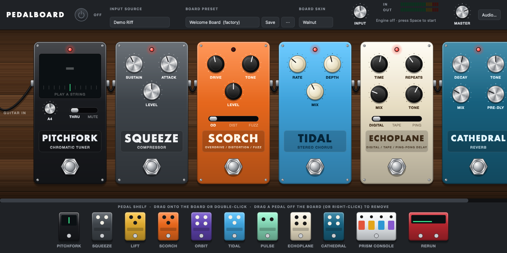
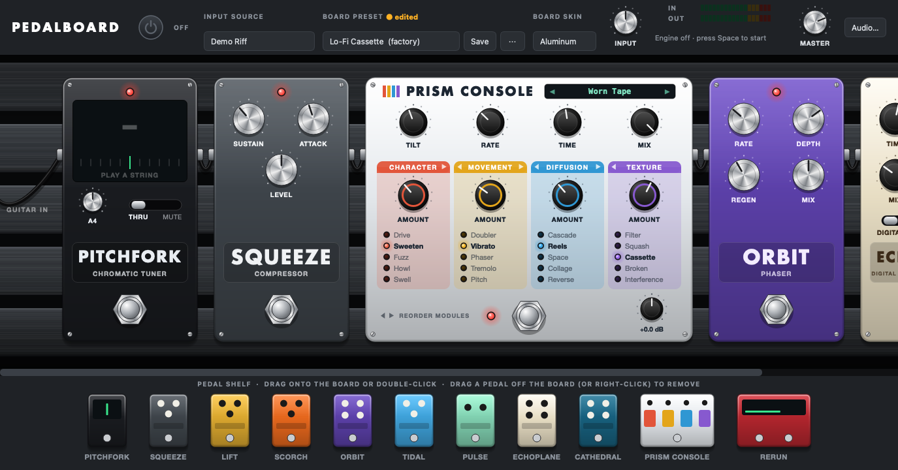
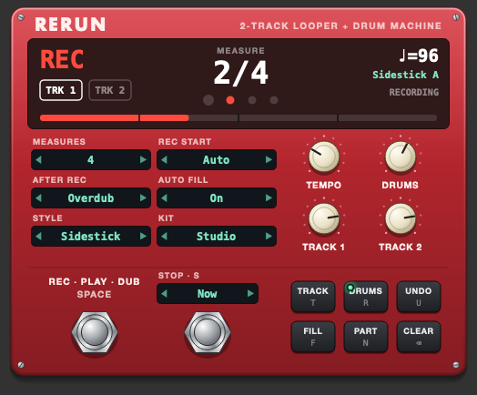

# Pedalboard

A real-time guitar pedalboard for macOS/Linux/Windows that looks and behaves like one:
painted stompboxes on a wooden board, patch cables between them, knobs you turn, footswitches
you stomp, and pedals you drag around to re-wire the signal chain.



## Quick start

```bash
pip install -r requirements.txt
python src/main.py
```

Then press the **power button** (or Space, while the engine is off). The input source starts on **Demo Riff** — a built-in
looping clean guitar part — so you can hear every pedal before plugging anything in.

To play through it, pick **Live Input** as the source, open **Audio…**, and choose your interface
and the input your guitar is on. On first run the app looks for a Focusrite Scarlett and assumes
the guitar is on input 2; output goes to the system default device. Use headphones with Live
Input, or the mic/speaker loop will feed back.

Handy flags: `--preset "Lo-Fi Cassette"` loads a board at startup, `--start` turns the engine on
immediately, `--screenshot out.png` renders the window to a file and exits.

## Using the board

| To… | Do this |
|---|---|
| Add a pedal | Drag it up from the shelf to where you want it, or double-click it |
| Re-order the chain | Drag a pedal by its body; the others slide out of the way. Signal flows left → right |
| Remove a pedal | Drag it off the board (up or down) and let go, or right-click → Remove |
| Switch a pedal on/off | Click its footswitch (the LED shows the state) |
| Turn a knob | Drag up/down. Shift-drag for fine control, scroll wheel to nudge, double-click to reset |
| See a knob's value | Hover over it — the label becomes the value |
| Duplicate / recolour / reset | Right-click the pedal (12 finishes to choose from) |
| Change the floor | **Board Skin**: Walnut, Tolex, Aluminum or Stage |
| Save your board | **Save** (⌘S). Factory presets are never overwritten — saving one makes your own copy |
| Play a recording through it | Input source → **Audio File…** (wav, aiff, flac, mp3, ogg; loops) |

The board, knob positions, skin and audio settings are restored the next time you open the app.

## The pedals

| Pedal | What it is | Controls |
|---|---|---|
| **Pitchfork** | Chromatic tuner (first on every factory board) | A4 reference, Thru / Mute |
| **Squeeze** | Compressor | Sustain, Attack, Level |
| **Lift** | Clean boost with 2-band EQ | Gain, Bass, Treble |
| **Scorch** | Overdrive / distortion / fuzz | Drive, Tone, Level, 3-way mode |
| **Orbit** | Phaser | Rate, Depth, Regen, Mix |
| **Tidal** | Stereo chorus | Rate, Depth, Mix |
| **Pulse** | Tremolo / auto-pan | Rate, Depth, Smooth / Chop / Pan |
| **Echoplane** | Delay | Time, Repeats, Mix, Tone, Digital / Tape / Ping-pong |
| **Cathedral** | Reverb | Decay, Tone, Mix, Pre-delay |
| **Prism Console** | Four-module texture workstation | see below |
| **Rerun** | Two-track looper with a drum machine | see below |

### Prism Console



Prism Console is this project's take on the Hologram **Chroma Console** pedal — and on XLN's
**RC-20 Retro Color**, the plugin that does the same kind of thing in a DAW. Four modules run in
series, each with five effects (one at a time) and one **Amount** knob:

| Module | Effects |
|---|---|
| **Character** | Drive · Sweeten · Fuzz · Howl · Swell |
| **Movement** | Doubler · Vibrato · Phaser · Tremolo · Pitch |
| **Diffusion** | Cascade · Reels · Space · Collage · Reverse |
| **Texture** | Filter · Squash · Cassette · Broken · Interference |

Click an effect name to select it; click the lit one again to switch that module off. The four
knobs across the top are global: **Tilt** (dark ↔ bright), **Rate** (modulation speed, or the
interval for Pitch), **Time** (echo time / reverb size) and **Mix**. The ◀ ▶ arrows on each module
header swap it with its neighbour, so you can put the fuzz after the echo instead of before it.
The little display steps through nine built-in textures (Worn Tape, Dying Walkman, Shortwave…),
which is the fastest way to hear what it can do.

It is an original implementation written from those products' published feature descriptions and
tuned by measurement, not by A/B against the hardware — treat it as "in the spirit of", not a
clone. Every effect is described in [docs/EFFECTS.md](docs/EFFECTS.md).

### Rerun looper



Rerun follows the Boss RC-500 workflow, driven from the keyboard until you have footswitches.
It controls the first looper on the board; the "Looper Rig" preset has one ready.

| Key | Does |
|---|---|
| **Space** | The main switch: record → overdub → play → overdub… Tap twice quickly to stop |
| **Space (hold)** | Undo the last overdub; hold again to redo |
| **S** | Stop the selected track — at once, or at the end of the loop (the **Stop** setting). Press S, T, S to queue both tracks to end together. S again on a waiting track stops it now; Space cancels |
| **Esc** | Stop everything immediately |
| **U** | Undo / redo |
| **T** | Switch between track 1 and track 2. Space on a stopped track brings it back in, in sync |
| **⌫** | Clear the selected track |
| **R** | Drums on/off (with nothing playing, they start on their own so you can hear the tempo) |
| **F** | Drum fill for the rest of this measure |
| **N** | Fill, then switch between the style's A and B parts (with a crash) |
| **↑ / ↓** | Tempo ± 1 bpm (before a loop is recorded) |

Settings on the pedal — click the right half of a field for next, the left half for previous:

- **Measures** — Free, or 1–16. With a fixed count the recording closes itself on the bar line.
- **Rec Start** — *Now*, *Auto* (arms, then starts on your first note) or *Count-in* (one measure of clicks).
- **After Rec** — go straight into *Overdub*, or *Play*.
- **Style / Kit** — 14 rhythm styles (Sidestick, Rock, Bossa, Train, Shuffle, Waltz, 6/8…) and four
  synthesised kits. The *Sidestick* kit turns every snare into a rim click.
- **Stop** (above the stop switch) — *Now* or *Loop End*.
- **Auto Fill** — a fill in the last measure of the loop (or every fourth measure).

The screen shows the state (red = recording, amber = overdub, green = play), which tracks hold
audio, the measure counter, a lamp per beat, tempo and loop progress.

Good to know: put the looper **last** so it records your effected sound. Its drums are mixed in
after the whole chain, so they are never recorded into the loop or run through later pedals.
Once a loop exists it owns the tempo — the Tempo knob only applies to the next loop. A free-length
loop recorded without drums sets the tempo from its length. Loops live in memory only; they are
not saved with the board.

## Recording into Logic

Set the app's output (under **Audio…**) to a BlackHole device and record from it in Logic.

- If it arrives far too quiet, check **Audio MIDI Setup → BlackHole → volume sliders** (input and
  output). They attenuate the loopback; both should be at 1.0 / 0 dB.
- To hear yourself without Logic's input monitoring, send the app to a *Multi-Output Device*
  (headphones + BlackHole) instead of BlackHole alone.

## Latency

Round-trip latency on a Scarlett 18i8 measures about **12 ms** at the default 128-sample buffer and
8 ms at 64, with the Scarlett as both input and output. Three things matter:

- **Use one device for input and output.** Scarlett in with the Mac's headphone jack out measured
  28 ms. Set the output device under **Audio…**.

- **Sample rate** defaults to *Match device*. Asking for a rate the interface isn't running at
  makes the OS resample the input, which measured ~40 ms worse on the Scarlett.
- **Buffer size** trades latency for headroom. If you hear crackles (most likely while dragging
  pedals around, when the UI competes with the audio thread), go up a size under **Audio…**.

The status line next to the meters shows the live sample rate, buffer, latency and audio CPU load.

## Development

```
src/
  main.py               launcher
  pedalfx/
    dsp/                pedals and DSP primitives (no UI imports)
    engine.py           audio I/O and the pedal chain
    sources.py          demo riff + audio file loader
    presets.py          factory boards, user boards, session file
    ui/                 PyQt6 widgets, all custom painted
tests/                  pytest suite (DSP, engine, presets, UI)
docs/                   effect reference and architecture notes
boards/                 your saved board presets (JSON)
specs/                  the original v1 feature spec (historical)
```

```bash
pytest          # ~200 tests, ~10 s, runs headless
ruff check .
```

See [docs/ARCHITECTURE.md](docs/ARCHITECTURE.md) for how the pieces fit and how to add a pedal.

Boards you save are JSON files in [`boards/`](boards/) in this repository, one per preset —
commit and push them to back them up or move them to another machine. The last session (audio
devices, the board as you left it) is per-machine, in `~/.pedalboard-effects/session.json`.
Setting the `PEDALFX_HOME` environment variable moves both into that folder instead.

## License

MIT — see [LICENSE](LICENSE).
